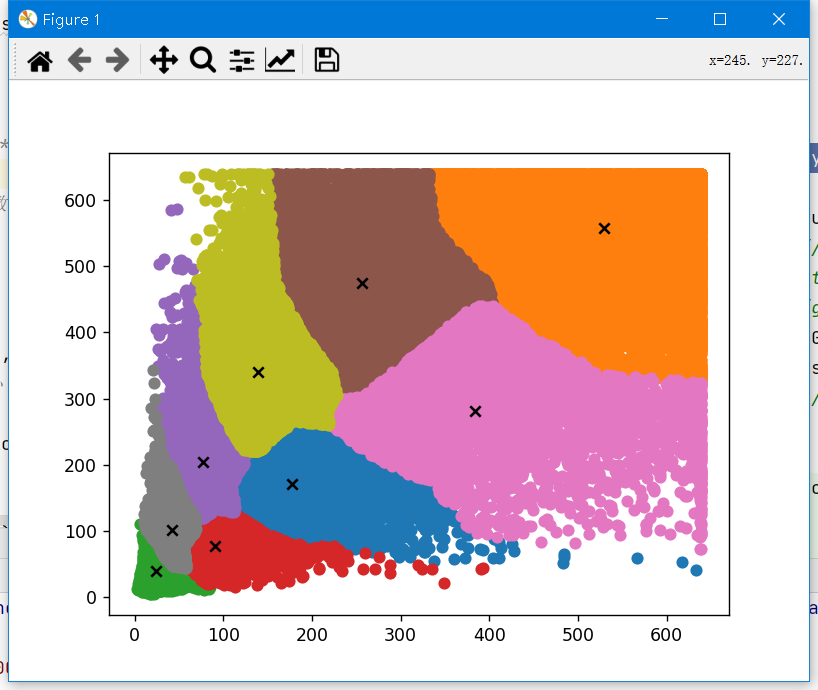

## 生成聚类图
```bash
python tools/kmeans_anchors++/yolo_kmeans.py
```
<summary>效果输出</summary>

<div>
<p align="left"></p>
</div>
在tools/kmeans_anchors++/yolo_kmeans.py中，实现了

    Args:
        boxes: 需要聚类的bboxes,bboxes为n*2包含w，h
        k: 簇数(聚成几类)
        dist: 更新簇坐标的方法(默认使用中位数，比均值效果略好)
        use_iou：是否使用IOU做为计算
        use_pp：是否是同k-means++算法
## anchor更改iou
**代码见utils/autoanchor.py  92行**

Ratio metric（比例度量）和IoU metric（交并比度量）是在计算机视觉中用于评估物体检测性能的两种度量标准。

Ratio metric是指通过计算检测框边界框与真实边界框之间的距离或重叠面积来评估检测框的精度。它通常用于衡量检测框位置的准确度，例如平均欧氏距离（Mean Euclidean Distance）或平均角度误差（Mean Angular Error）等。

而IoU metric是指通过计算检测框和真实边界框之间的交集和并集的比例来评估检测框的精度。它常用于衡量对象检测任务的准确度，例如平均交并比（Mean Intersection over Union）等。

综上所述，Ratio metric和IoU metric都是用于衡量物体检测性能的指标，但它们所关注的方面略有不同。Ratio metric主要关注检测框位置的精度，而IoU metric则主要关注检测框和真实边界框之间的重叠程度
